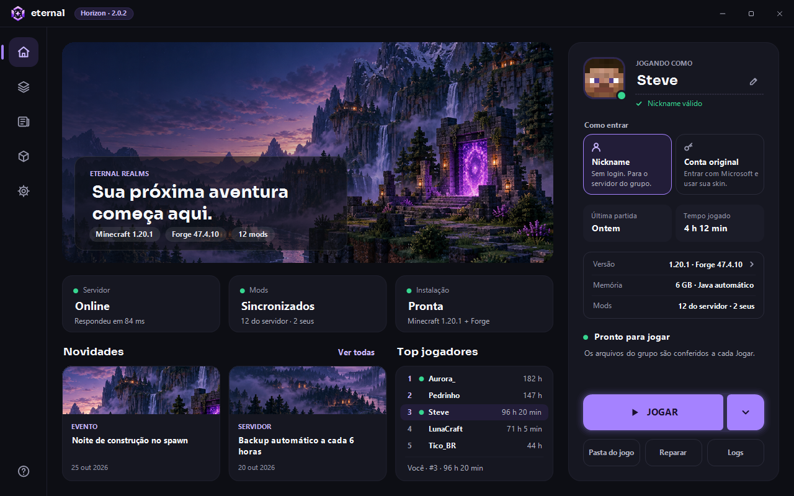
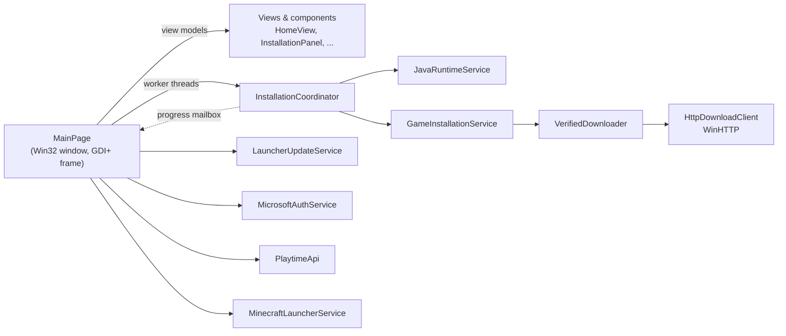

<div align="center">

# Eternal Launcher

**A native Windows game launcher in C++20 and the raw Win32 API: no frameworks,
no web runtime, one portable executable.**

[](https://github.com/ryanbworks/native-game-launcher/actions/workflows/build.yml)
[](https://github.com/ryanbworks/native-game-launcher/releases/latest)
[](LICENSE)


[Download](https://github.com/ryanbworks/native-game-launcher/releases/latest) ·
[User guide](docs/USER_GUIDE.md) ·
[Architecture](docs/ARCHITECTURE.md) ·
[Changelog](CHANGELOG.md)



</div>

Eternal Launcher installs, updates and starts a modded Minecraft (1.20.1 + Forge)
for a private community server. One click takes a player from a fresh Windows
machine to the game: it provisions a portable Java runtime, installs Minecraft and
Forge from the official sources, syncs the server's mods, and keeps itself up to
date with signed releases.

It is about 12,000 lines of C++ with a custom-drawn interface, plus a small Python
backend for play time and a CI pipeline that builds, tests, signs and publishes
each release. The interface is in Brazilian Portuguese; the code and docs are in
English.

## Highlights

**Custom UI renderer on GDI+.** Every page is drawn into one off-screen frame on a
1280 × 800 logical canvas that scales with the window and DPI. Animation frames
repaint only the regions that changed and present them with `BitBlt`. Interactive
elements are real owner-drawn Win32 controls placed over the frame, so Tab order,
focus, Enter/Space and the Windows "show animations" setting all work natively.
→ [Design](docs/DESIGN.md) · [Animations](docs/ANIMATIONS.md)

**Signed self-update with rollback.** Releases are signed with RSA-PSS/SHA-256 and
verified against a public key embedded in the executable. The update swaps the
executable, keeps a backup, and rolls back automatically if the new version does
not confirm it started within 30 seconds. Covered by dozens of integration checks
(corruption, timeouts, locking, concurrent runs).
→ [AutoUpdate](docs/AUTOUPDATE.md)

**Verified, cancellable installation pipeline.** Game files are planned from
Mojang's manifests, downloaded in parallel over asynchronous WinHTTP, checked with
SHA-1/SHA-256 (Windows CNG) and published atomically from `.part` files. The
pipeline runs on a worker thread and reports progress to the UI through a mailbox;
it can be cancelled at any stage without losing verified files or worlds.
→ [Installation tracking](docs/INSTALLATION_TRACKING.md) · [Minecraft launch](docs/MINECRAFT_LAUNCH.md)

**Microsoft account sign-in.** OAuth 2.0 device-code flow through Microsoft, Xbox
Live and XSTS to a Minecraft Services token, kept in memory only and never logged.

**Tamper-resistant play time.** A Python service measures play time with the
server's own clock from heartbeats; the client never reports a duration. The home
page shows a leaderboard from it.
→ [server/](server/INSTALL.md)

**Release automation.** GitHub Actions builds and tests every push (C++ with CTest,
Python with `unittest`), with third-party actions pinned by commit SHA. A manual
workflow signs the release and publishes it to the file server, then verifies the
download over HTTPS before announcing the update.
→ [Publishing](server/GITHUB_ACTIONS.md)

## Architecture



Views only draw the data they receive and never touch the network or disk; all I/O
lives in services behind interfaces, which is what lets the UI tests run a full
installation flow against fakes. Details in [ARCHITECTURE.md](docs/ARCHITECTURE.md).

## Tech stack

| Area | Choice |
| --- | --- |
| Language & build | C++20, CMake presets, MSVC `/W4 /permissive-` |
| UI | Win32 API, GDI+, DWM, owner-drawn native controls |
| Networking | WinHTTP (asynchronous, cancellable) |
| Crypto | Windows CNG: SHA-1/SHA-256, RSA-PSS signature verification |
| Backend | Python service behind NGINX, systemd timers |
| CI/CD | GitHub Actions, PowerShell release tooling |

No third-party C++ libraries: JSON parsing, ZIP extraction and the drawing
primitives are implemented in the project or use what Windows already ships.

## Building

Requires Visual Studio 2022 or later with **Desktop development with C++** (CMake
and Ninja included). From a *Developer PowerShell for VS*:

```powershell
cmake --preset x64-debug
cmake --build out/build/x64-debug
ctest --test-dir out/build/x64-debug --output-on-failure
./out/build/x64-debug/EternalLauncher.exe
```

`x64-release`, `x86-debug` and `x86-release` presets are also available. PowerShell 7
enables the AutoUpdate integration tests.

To render every screen to PNG without network access, login or Minecraft:

```powershell
./out/build/x64-debug/EternalLauncher.exe --render-preview out/ui-preview
```

## Tests

| Suite | What it covers |
| --- | --- |
| `WindowPaintingTests` | Hosts the real window: navigation, control visibility, keyboard focus, installation flow against fakes, animation behavior and frame timings |
| `InstallationTrackingTests` | Coordinator stages, cancellation at every stage, cache reuse, world preservation |
| `MinecraftLauncherServiceTests` | Launch identity and commands, portable Java checks, mod cleanup against the manifest, nickname rules |
| `LauncherServicesTests` | Play time, leaderboard, news feed, mod inventory, skin lookup parsing |
| `LauncherSettingsTests`, `SettingsPageTests` | Settings validation, atomic persistence, settings UI |
| `LauncherAutoUpdateTests` | Real executable swaps, rollback, corruption, timeouts, locking |
| Python (`server/`, `tests/`) | Manifest generation, play time API, release publisher |

## Project layout

```text
src/
├── app/          Application lifecycle and message loop
├── pages/        Window, page composition and interaction
├── components/   Views drawn with GDI+ (home, installation, settings, ...)
├── services/     HTTP, installation, launch, auth, update, play time
├── config/       Versions, endpoints and persisted settings
├── types/        Shared state and progress contracts
├── utils/        JSON, hashing, archives, drawing
└── styles/       Color and shape tokens
tests/            C++ and Python test suites
server/           Play time API, manifest service, deployment scripts
tools/            Release, signing and verification tooling
docs/             Architecture, design and operations docs
```

## Documentation

- [User guide](docs/USER_GUIDE.md): installing, accounts, settings, server administration
- [Architecture](docs/ARCHITECTURE.md) and [interface design](docs/DESIGN.md)
- [Installation tracking](docs/INSTALLATION_TRACKING.md) and [Minecraft launch](docs/MINECRAFT_LAUNCH.md)
- [AutoUpdate](docs/AUTOUPDATE.md), [HTTP server](docs/HTTP_SERVER.md) and [server setup](server/INSTALL.md)

## License

[MIT](LICENSE). Minecraft is a trademark of Mojang Studios; this project is not
affiliated with or endorsed by Mojang or Microsoft.
