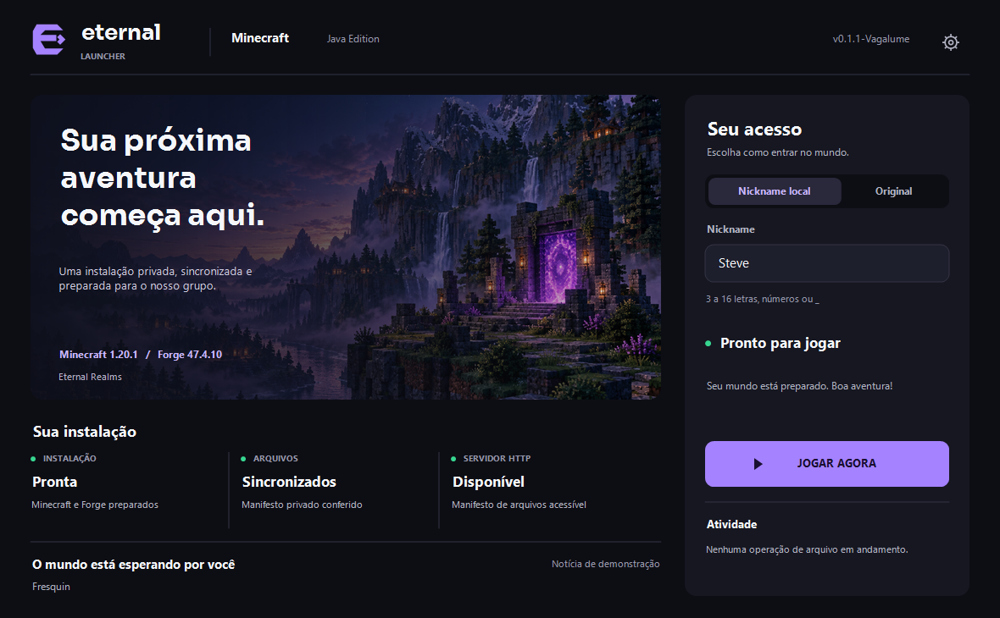

<div align="center">

# Eternal Launcher

**Native Windows launcher that prepares and starts the Eternal server's Minecraft Forge setup in one click.**

[](https://github.com/ryanbworks/Eternal-Launcher/actions/workflows/build.yml)
[](https://github.com/ryanbworks/Eternal-Launcher/releases/latest)


[**⬇️ Download the latest version**](https://github.com/ryanbworks/Eternal-Launcher/releases/latest) ·
[Changelog](CHANGELOG.md) ·
[Architecture](docs/ARCHITECTURE.md)

</div>

Private desktop launcher for a standardized Minecraft `1.20.1` installation with
Forge `47.4.10`. It reads an HTTP manifest, prepares an isolated instance and
starts the game with the chosen nickname.

> The launcher's interface is in Brazilian Portuguese. UI labels below are quoted
> as they appear in the app, followed by their English meaning.



Illustrative preview of the current design. The real window shows the live status
of the services. The interface has its own brand, a built-in landscape, violet
accents, smooth transitions and native controls with keyboard navigation.

## Download and use

Download [Eternal Launcher v2.0.0-Horizon](https://eternalfast.aplot.cloud/launcher/releases/2.0.0/EternalLauncher.exe)
(see [what's new](https://github.com/ryanbworks/Eternal-Launcher/releases/latest)).
The distribution is a single portable executable for Windows x64. Open
`EternalLauncher.exe`. The launcher ships with the C++ runtime and sets up Java 17
automatically the first time you click **Jogar** (Play), with an internet connection.

Users of v0.1.1-Vagalume need to replace the executable manually once.
Since Aurora, the launcher checks for new versions on startup and asks before downloading.
After you confirm with **OK**, it updates and restarts automatically.
Preferences and game files are preserved. If the update fails, the launcher lets
you keep using the installed version and offers a manual download.

To publish a new version, use Actions → **Publish launcher** → Run workflow:
GitHub builds, tests, signs and publishes to the server, verifying the download
over HTTPS before announcing the update. See the [publishing guide](server/GITHUB_ACTIONS.md).
The local wizard [PrepareUpdate.cmd](PrepareUpdate.cmd) is still available as an
alternative ([step by step](docs/AUTOUPDATE.md#two-click-wizard)).

## Features

- Resizable native Windows interface with a custom title bar, a navigation rail (Home, News, Mods, Settings, Help), a dark theme and DPI scaling.
- Play time per session and in total; while Minecraft runs, an icon next to the clock keeps counting even if the window is closed.
- News page fed by an optional `news.json` on the file server ([format](docs/ARCHITECTURE.md#news-feed)).
- Mods page separating server mods from your own, with enable/disable, add and send to the Recycle Bin.
- Help page with repair, logs and copyable support information.
- Vector logo and custom icon, with the landscape and font embedded in the executable.
- Portal opening, three-layer particles, a light that follows the cursor on the Play button, page fades and eased hover feedback, all respecting the Windows animation preference. [Animation details](docs/ANIMATIONS.md).
- Choice between a local nickname and an original Microsoft account login.
- Nickname field validated to 3–16 letters, digits or `_`.
- Asynchronous query of the configured HTTP server's manifest.
- Executable AutoUpdate with RSA-PSS/SHA-256 signatures, backup and rollback.
- Automatic discovery of mods uploaded to the server's `mods/` folder.
- Automatic download of a portable Java 17 from the official Eclipse Adoptium API.
- Automatic installation of the Minecraft client, libraries, assets and Forge.
- SHA-1/SHA-256 verification and atomic publication of downloads.
- Synchronization of the files listed under `files` in the private manifest.
- Removal of launcher-installed mods that left the manifest, preserving mods added by the player.
- Forge installer log and automatic recovery from portable Java failures.
- Native library extraction and a controlled classpath.
- Real Forge launch with a technical log at `logs/launcher-console.log`.
- Isolated instance at `%APPDATA%\.eternal-launcher\minecraft` or in a dedicated folder of your choice.
- Persistent settings for RAM, resolution, fullscreen, Java and game folder.
- Hide in the notification area while playing, return when the game exits, and shortcuts to the game, mods and logs folders.

In **Nickname local** (local nickname) mode, the private server must accept offline
sessions. In **Original** mode, the launcher gets the name, UUID and token of the
authenticated account's Minecraft: Java Edition profile. The session lives only in
memory and is requested again when the launcher is reopened.

### Minecraft settings

Open the gear icon in the header to adjust:

- Maximum RAM slider in 0.5 GB steps: 1, 1.5, 2, 4.5, 6.5 GB and so on, with 4, 6 and 8 GB shortcuts.
- Initial/maximum RAM fields in MiB for precise values (512 to 65536; initial cannot exceed maximum).
- Window width and height, with an option to start in fullscreen.
- Automatic Java 17 or a custom executable (`java.exe` / `javaw.exe`).
- Dedicated instance folder and minimizing the launcher while playing.

The slider works with the mouse and the arrow keys. In this selector, 1 GB equals
1024 MiB (6.5 GB = 6656 MiB). The initial 0.5–16 GB range grows to fit larger
values that are typed or already saved. Slider, shortcuts and numeric field stay
in sync; if a shortcut lowers the maximum below the initial value, the initial
value is lowered too.

**Salvar preferências** (Save preferences) applies the values from the next session.
**Cancelar** (Cancel), **Voltar** (Back) or Esc discard unsaved changes.
**Restaurar padrões** (Restore defaults) fills in the form; click Save to apply.
Values are stored in `%APPDATA%\.eternal-launcher\settings.json` with atomic writes.
An invalid file is preserved and the launcher loads the defaults, showing a warning
on the settings screen.

Automatic mode looks for Java 17 in the private runtime, in `JAVA_HOME` and on the
`PATH`, and prepares the private runtime when needed. Custom mode requires a Java 17
installation with a `release` file and `bin/java.exe` available to prepare Forge.
Preferences are locked during login, preparation and while Minecraft is running.

Changing the folder prepares a different instance: your worlds stay in the previous
folder. Choose an empty folder or an instance already created by Eternal. The default
`.minecraft` folder, the drive root and the launcher's internal data are protected.
The **Abrir jogo**, **Abrir mods** and **Abrir logs** shortcuts (open game, mods and
logs folders) use the saved instance. **Minimizar launcher ao jogar** (minimize
launcher while playing) is on by default, including after restoring defaults. The
launcher comes back when the game exits. If you turn it off and save, that choice
persists across launches.


### Original login setup

The public Application (client) ID is already configured in
`src/config/LauncherConfig.h` and ships with the compiled executable. To use a
different registration without rebuilding, set the environment variable before
starting the launcher:

```powershell
$env:ETERNAL_LAUNCHER_MICROSOFT_CLIENT_ID = "YOUR-APPLICATION-CLIENT-ID"
./out/build/x64-debug/EternalLauncher.exe
```

The ID is public; never put a client secret in the executable. After choosing
**Original** and clicking **Jogar**, open the URL shown, enter the code and finish
signing in through the browser. The account must own a Minecraft: Java Edition
profile. Microsoft/Minecraft may also require specific authorization for the app
registration; if the service responds with `Invalid app registration` (HTTP 403),
the Microsoft and Xbox sign-in reached Minecraft Services, but the service rejected
the Application ID. Changing the ID in the executable or rebuilding does not grant
that authorization. The error points to `https://aka.ms/AppRegInfo`. A developer
with the same error reported getting Mojang approval after submitting the Client ID
through the [application registration form](https://forms.cloud.microsoft/Pages/ResponsePage.aspx?id=v4j5cvGGr0GRqy180BHbR-ajEQ1td1ROpz00KtS8Gd5UNVpPTkVLNFVROVQxNkdRMEtXVjNQQjdXVC4u).
Approval depends on Microsoft/Mojang's review. Until the registration is
authorized, Original mode cannot start an online session; local nickname mode
remains available.

## First run

On startup, the launcher first checks for its own update and then shows the state
of the local installation. Game downloads start when you click **Jogar**:

```text
Prepare portable Java 17
  → read Mojang's official manifests
  → download and verify Minecraft, libraries and assets
  → extract native DLLs
  → download and run the official Forge 47.4.10 installer
  → synchronize the private manifest's files
  → start the game with the chosen nickname
```

Downloads that are already valid are reused. Incomplete files use the `.part`
extension and only replace the destination after the hash is verified.

### Tracking and cancelling the installation

After clicking **Jogar**, the left area shows six stages: checks and Java 17,
Minecraft and assets, native libraries, Forge, mods and configuration, and final
validation. The account and the summary stay on the right. Minecraft opens
automatically when preparation finishes successfully.

During transfers, the panel shows downloaded bytes, the current transfer's
percentage, speed, remaining time when it can be estimated, and verified/reused
files. Cached files don't count as traffic. Extraction, verification and the Forge
run use an activity indicator; transfers without a known size show no percentage
or estimate.

**Cancelar instalação** (Cancel installation) requests a stop and shows
**Cancelando…** (Cancelling…) until tasks finish. **Continuar instalação** (Continue
installation) and **Tentar novamente** (Try again) read the manifests again and
reuse complete, verified files. This version restarts partial files; it offers
neither pause nor byte-level resume. Cancelling prevents the game from opening
automatically and preserves existing worlds.

Failures appear in the panel itself with recovery guidance. **Abrir log** (Open log)
opens `logs/installation.log` of the saved instance; Forge failures also point to
`logs/forge-installer.log`. Preparation logs never include Microsoft identity,
tokens or URLs with credentials. Closing the window during preparation requests
cancellation and waits for cleanup before destroying the window.


Preview with synthetic values, rendered by the production GDI+ renderer.

## Still simulated or planned

- News shown on the main screen.

## Technology

- C++20, CMake and the Win32 API;
- GDI+ for the interface;
- WinHTTP for downloads;
- Windows CNG (`bcrypt`) for hashes and local UUIDs;
- Eclipse Temurin 17 as the portable runtime.

There is no coupling to NGINX. Any HTTP server able to serve the manifest and the
files can be used.

## Building

In Visual Studio, open the folder, pick a preset from `CMakePresets.json` and build
the `EternalLauncher` target. In a Developer PowerShell:

```powershell
cmake --preset x64-debug
cmake --build out/build/x64-debug
ctest --test-dir out/build/x64-debug --output-on-failure
./out/build/x64-debug/EternalLauncher.exe
```

The `x64-release`, `x86-debug` and `x86-release` presets are also available.

To start from the IDE, select **x64 Debug** or **x64 Release** and the
**EternalLauncher.exe** target. PowerShell 7 is required to build releases and run
the AutoUpdate integration tests; without it you can still build and run the
launcher from Visual Studio.

## Project layout

```text
assets/                       Embedded brand, landscape, icon and font
docs/                         Documentation and screenshots
src/
├── app/                      Application lifecycle
├── components/               Visual components
├── config/                   Versions, URLs and memory
├── constants/                Shared IDs and dimensions
├── mocks/                    Content that is still simulated
├── pages/                    Screen composition and interaction
├── services/                 HTTP, installation and launch
├── styles/                   Palette and typography
├── types/                    Shared state
└── utils/                    JSON, hashes, files and drawing
tests/                        Automated tests and local diagnostics
```

Further documentation:

- [Project architecture](docs/ARCHITECTURE.md)
- [Minecraft launch](docs/MINECRAFT_LAUNCH.md)
- [HTTP file server](docs/HTTP_SERVER.md)
- [AutoUpdate and publishing with FileZilla](docs/AUTOUPDATE.md)

## Central configuration

The launcher's version and codename live in `CMakeLists.txt`, which generates the
values shared by the interface and the executable. Memory, game versions and the
server live in `src/config/LauncherConfig.h`. To change the current address, edit
`FileServerBaseUrl` and rebuild. The launcher gets Minecraft from the official
services and uses this server only for the manifest, mods, configs and other
private files.

The launcher does not add the Minecraft server automatically. Add the IP manually
on the game's Multiplayer screen. That list belongs to the isolated installation at
`%APPDATA%\.eternal-launcher\minecraft`.

To distribute mods, upload the `.jar` files over SFTP to
`/srv/eternal-launcher/files/mods/`. Configs can be uploaded to
`/srv/eternal-launcher/files/config/`, keeping the path Minecraft expects. A
service on the server updates the manifest automatically; when you click **Jogar**,
the launcher fetches the latest list.

A valid nickname is saved automatically when you click **Jogar** or close the
launcher, and it shows up in the field the next time. It is stored in
`%APPDATA%\.eternal-launcher\nickname.txt`; this is not an account or authentication.

## Roadmap

- Move the HTTP URL into persisted settings.
- Extend obsolete-file removal to file types beyond mods.
