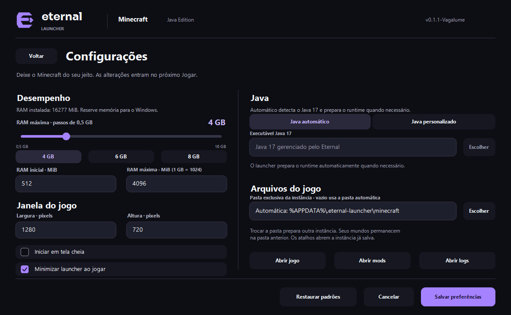
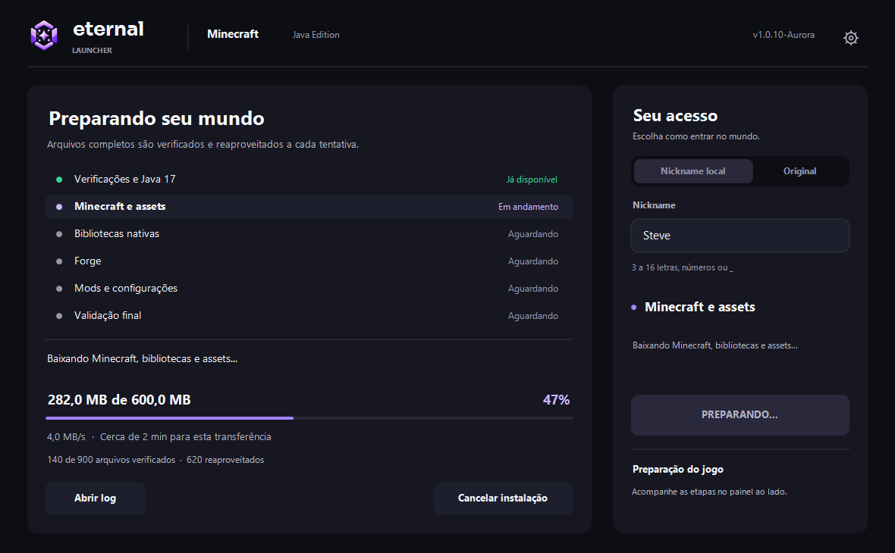

# Eternal Launcher

Launcher desktop privado para uma instalação padronizada de Minecraft `1.20.1`
com Forge `47.4.10`. A aplicação consulta um manifesto HTTP, prepara uma
instância isolada e inicia o jogo com o nickname informado.


Prévia ilustrativa do novo design. A janela real exibe o estado consultado dos
serviços. A interface usa uma marca própria, paisagem incorporada, detalhes
violeta, transições suaves e controles nativos com navegação por teclado.

## Baixar e usar

Baixe o [Eternal Launcher v1.0.0-Aurora](https://eternalfast.aplot.cloud/launcher/releases/1.0.0/EternalLauncher.exe).
A distribuição é um único executável portátil para Windows x64. Abra
`EternalLauncher.exe`. O launcher inclui o runtime C++ e prepara o Java 17
automaticamente no primeiro clique em **Jogar**, com conexão à internet.

Quem usa a v0.1.1-Vagalume precisa substituir o executável manualmente uma vez.
A Aurora verifica as próximas versões na abertura e pergunta antes de baixar.
Ao confirmar com **OK**, atualiza e reabre automaticamente.
Preferências e arquivos do jogo são preservados. Se o update falhar, o launcher
permite continuar na versão instalada e oferece o download manual.

Para preparar uma próxima versão, abra [PrepararAtualizacao.cmd](PrepararAtualizacao.cmd).
O assistente pede a versão, compila, testa e gera a pasta `FILEZILLA` com o
executável e o JSON assinado. Depois, guia o envio e a conferência pelo HTTPS.
Veja o [passo a passo de publicação](docs/AUTOUPDATE.md#assistente-de-dois-cliques).

## Funcionalidades atuais

- Interface nativa redimensionável para Windows, tema escuro e escala de DPI.
- Logo vetorial e ícone próprio, com paisagem e fonte embutidas no executável.
- Abertura do portal, partículas em três camadas, luz acompanhando o cursor no Jogar, navegação animada nas configurações e transição para a instalação, respeitando a preferência de animação do Windows. [Detalhes das animações](docs/ANIMACOES.md).
- Escolha entre nickname local e login original com conta Microsoft.
- Campo de nickname com validação de 3 a 16 letras, números ou `_`.
- Consulta assíncrona ao manifesto do servidor HTTP configurado.
- AutoUpdate do executável com assinatura RSA-PSS/SHA-256, backup e rollback.
- Descoberta automática dos mods enviados à pasta `mods/` do servidor.
- Download automático do Java 17 portátil pela API oficial do Eclipse Adoptium.
- Instalação automática do cliente Minecraft, bibliotecas, assets e Forge.
- Verificação de SHA-1/SHA-256 e publicação atômica dos downloads.
- Sincronização dos arquivos descritos em `files` no manifesto privado.
- Remoção de mods locais que saíram do manifesto após a sincronização.
- Log do instalador Forge e recuperação automática de falhas do Java portátil.
- Extração das bibliotecas nativas e geração de classpath controlado.
- Inicialização real do Forge e log técnico em `logs/launcher-console.log`.
- Instância isolada em `%APPDATA%\.eternal-launcher\minecraft` ou em uma pasta exclusiva escolhida.
- Configurações persistentes de RAM, resolução, tela cheia, Java e pasta do jogo.
- Minimizar ao jogar, retornar após o jogo encerrar e atalhos para jogo, mods e logs.

No modo **Nickname local**, o servidor privado precisa aceitar sessões offline.
No modo **Original**, o launcher obtém nome, UUID e token do perfil Minecraft:
Java Edition da conta autenticada. A sessão fica apenas na memória e é solicitada
novamente quando o launcher é reaberto.

### Configurar Minecraft

Abra a engrenagem no cabeçalho para ajustar:

- Barra de RAM máxima em passos de 0,5 GB: 1, 1,5, 2, 4,5, 6,5 GB etc., com atalhos de 4, 6 e 8 GB.
- Campos de RAM inicial/máxima em MiB para valores precisos (512 a 65536; inicial não pode superar a máxima).
- Largura e altura da janela, com opção de iniciar em tela cheia.
- Java 17 automático ou executável personalizado (`java.exe` / `javaw.exe`).
- Pasta exclusiva da instância e minimização do launcher ao jogar.

A barra funciona com mouse e setas do teclado. Neste seletor, 1 GB corresponde
a 1024 MiB (6,5 GB = 6656 MiB). A faixa inicial de 0,5 a 16 GB cresce para
acomodar valores maiores digitados ou já salvos. Barra, atalhos e campo numérico
ficam sincronizados; se um atalho reduzir a máxima abaixo da inicial, a inicial
também é reduzida.

**Salvar preferências** aplica os valores na próxima sessão. **Cancelar**, **Voltar**
ou Esc descartam alterações não salvas. **Restaurar padrões** preenche o formulário;
clique em Salvar para aplicar. Os valores ficam em
`%APPDATA%\.eternal-launcher\settings.json`, com gravação atômica. Um arquivo inválido
é preservado e o launcher carrega os padrões com um aviso na tela de configurações.

O modo automático procura Java 17 no runtime privado, em `JAVA_HOME` e no `PATH`;
prepara o runtime privado se necessário. O modo personalizado exige uma instalação
Java 17 com arquivo `release` e `bin/java.exe` disponível para preparar o Forge.
As preferências ficam bloqueadas durante login, preparação e execução do Minecraft.

Trocar a pasta prepara outra instância: seus mundos permanecem na pasta anterior.
Escolha uma pasta vazia ou uma instância já criada pelo Eternal. A pasta padrão
`.minecraft`, a raiz do disco e os dados internos do launcher são protegidos.
Os atalhos **Abrir jogo**, **Abrir mods** e **Abrir logs** usam a instância salva.
**Minimizar launcher ao jogar** vem ativado por padrão, inclusive ao restaurar
os padrões. O launcher retorna após o jogo encerrar. Se você desativar e salvar,
essa escolha permanece nas próximas aberturas.



### Configurar login original

O Application (client) ID público já está configurado em
`src/config/LauncherConfig.h` e acompanha o executável compilado. Para usar
outro registro sem recompilar, defina a variável de ambiente antes de abrir o
launcher:

```powershell
$env:ETERNAL_LAUNCHER_MICROSOFT_CLIENT_ID = "SEU-APPLICATION-CLIENT-ID"
./out/build/x64-debug/EternalLauncher.exe
```

O ID é público; nunca coloque um client secret no executável. Ao escolher
**Original** e clicar em **Jogar**, abra a URL mostrada,
digite o código e conclua o login no navegador. A conta precisa possuir um
perfil Minecraft: Java Edition. A Microsoft/Minecraft também pode exigir
autorização específica do registro do aplicativo; se o serviço responder
`Invalid app registration` (HTTP 403), o login Microsoft e Xbox chegou ao
Minecraft Services, mas o serviço recusou o Application ID. Mudar o ID no
executável ou recompilar não concede essa autorização. O erro aponta para
`https://aka.ms/AppRegInfo`. Um desenvolvedor com o mesmo erro relatou ter
obtido aprovação da Mojang após enviar o Client ID pelo [formulário de registro
de aplicativo](https://forms.cloud.microsoft/Pages/ResponsePage.aspx?id=v4j5cvGGr0GRqy180BHbR-ajEQ1td1ROpz00KtS8Gd5UNVpPTkVLNFVROVQxNkdRMEtXVjNQQjdXVC4u).
A aprovação depende da análise da Microsoft/Mojang. Enquanto o registro não
for autorizado, o modo Original não conseguirá iniciar uma sessão online; o
modo de nickname local continua disponível.

## Primeiro uso

Ao abrir, o launcher verifica primeiro sua própria atualização e depois mostra
o estado da instalação local. Os downloads do jogo começam ao clicar em **Jogar**:

```text
Preparar Java 17 portátil
  → consultar manifestos oficiais da Mojang
  → baixar e verificar Minecraft, bibliotecas e assets
  → extrair DLLs nativos
  → baixar e executar o instalador oficial do Forge 47.4.10
  → sincronizar os arquivos do manifesto privado
  → iniciar o jogo com o nickname escolhido
```

Downloads já válidos são reaproveitados. Arquivos incompletos usam a extensão
`.part` e só substituem o destino depois da conferência do hash.

### Acompanhar e cancelar a instalação

Ao clicar em **Jogar**, a área esquerda passa a mostrar seis etapas: verificações
e Java 17, Minecraft e assets, bibliotecas nativas, Forge, mods e configurações,
e validação final. A conta e o resumo continuam à direita. O Minecraft abre
automaticamente quando a preparação termina com sucesso.

Durante transferências, o painel mostra bytes baixados, percentual da
transferência atual, velocidade, estimativa restante quando calculável e
arquivos verificados/reaproveitados. Arquivos em cache não contam como tráfego.
Extração, verificação e execução do Forge usam um indicador de atividade;
transferências sem tamanho conhecido não exibem percentual ou estimativa.

**Cancelar instalação** solicita parada e mostra **Cancelando…** até encerrar
as tarefas. **Continuar instalação** e **Tentar novamente** consultam os
manifestos novamente e reaproveitam arquivos completos verificados. Esta versão
reinicia os arquivos parciais; não oferece pausa nem retomada por bytes.
Cancelamento impede a abertura automática do jogo e preserva mundos existentes.

Falhas aparecem no próprio painel com orientação de recuperação. **Abrir log**
acessa `logs/installation.log` da instância salva; falhas do Forge também
indicam `logs/forge-installer.log`. Os logs da preparação não incluem identidade
Microsoft, tokens ou URLs com credenciais. Fechar durante a preparação solicita
cancelamento e aguarda a limpeza antes de destruir a janela.



Prévia com valores sintéticos, gerada pelo renderer GDI+ de produção.

## O que ainda é simulado ou futuro

- Notícias exibidas na tela principal.

## Tecnologias

- C++20, CMake e Win32 API;
- GDI+ para a interface;
- WinHTTP para downloads;
- Windows CNG (`bcrypt`) para hashes e UUID local;
- Eclipse Temurin 17 como runtime portátil.

Não existe acoplamento ao NGINX. Qualquer servidor HTTP capaz de publicar o
manifesto e os arquivos pode ser utilizado.

## Como compilar

No Visual Studio, abra a pasta, selecione um preset de `CMakePresets.json` e
compile o alvo `EternalLauncher`. Em um Developer PowerShell:

```powershell
cmake --preset x64-debug
cmake --build out/build/x64-debug
ctest --test-dir out/build/x64-debug --output-on-failure
./out/build/x64-debug/EternalLauncher.exe
```

Também existem os presets `x64-release`, `x86-debug` e `x86-release`.

Para iniciar pela IDE, selecione **x64 Debug** ou **x64 Release** e o alvo
**EternalLauncher.exe**. PowerShell 7 é necessário para gerar releases e executar
os testes de integração do AutoUpdate; sua ausência não impede compilar ou
executar o launcher pelo Visual Studio.

## Organização

```text
assets/                       Marca, paisagem, ícone e fonte incorporados
docs/                         Documentação e capturas
src/
├── app/                      Ciclo de vida da aplicação
├── components/               Componentes visuais
├── config/                   Versões, URLs e memória
├── constants/                IDs e dimensões compartilhadas
├── mocks/                    Conteúdo ainda simulado
├── pages/                    Composição e interação das telas
├── services/                 HTTP, instalação e inicialização
├── styles/                   Paleta e tipografia
├── types/                    Estados compartilhados
└── utils/                    JSON, hashes, arquivos e desenho
tests/                        Testes automatizados e diagnósticos locais
```

Documentação complementar:

- [Arquitetura do projeto](docs/ARQUITETURA.md)
- [Inicialização do Minecraft](docs/INICIALIZACAO_MINECRAFT.md)
- [Servidor HTTP de arquivos](docs/SERVIDOR_HTTP.md)
- [AutoUpdate e publicação pelo FileZilla](docs/AUTOUPDATE.md)

## Configuração central

Versão e codinome do launcher ficam em `CMakeLists.txt`, que gera os valores
compartilhados pela interface e pelo executável. Memória, versões do jogo e
servidor ficam em `src/config/LauncherConfig.h`. Para trocar
o IP atual, altere `FileServerBaseUrl` e recompile. O launcher obtém Minecraft
dos serviços oficiais e usa esse servidor apenas para o manifesto, mods,
configurações e outros arquivos privados.

O launcher não configura o servidor Minecraft automaticamente. Adicione o IP
manualmente na tela Multiplayer do jogo. Essa lista pertence à instalação
isolada em `%APPDATA%\.eternal-launcher\minecraft`.

Para distribuir mods, basta enviar os `.jar` via SFTP para
`/srv/eternal-launcher/files/mods/`. Configurações podem ser enviadas para
`/srv/eternal-launcher/files/config/`, preservando o caminho esperado pelo
Minecraft. O serviço no servidor atualiza o manifesto automaticamente; ao
clicar em **Jogar**, o launcher busca a lista mais recente.

O nickname válido é salvo automaticamente ao clicar em **Jogar** ou fechar o
launcher. Na próxima abertura ele reaparece no campo. O valor fica em
`%APPDATA%\.eternal-launcher\nickname.txt`; isso não é uma conta ou autenticação.

## TODOs principais

- Mover a URL HTTP para configurações persistidas.
- Estender a remoção de arquivos obsoletos para outros tipos além dos mods.
