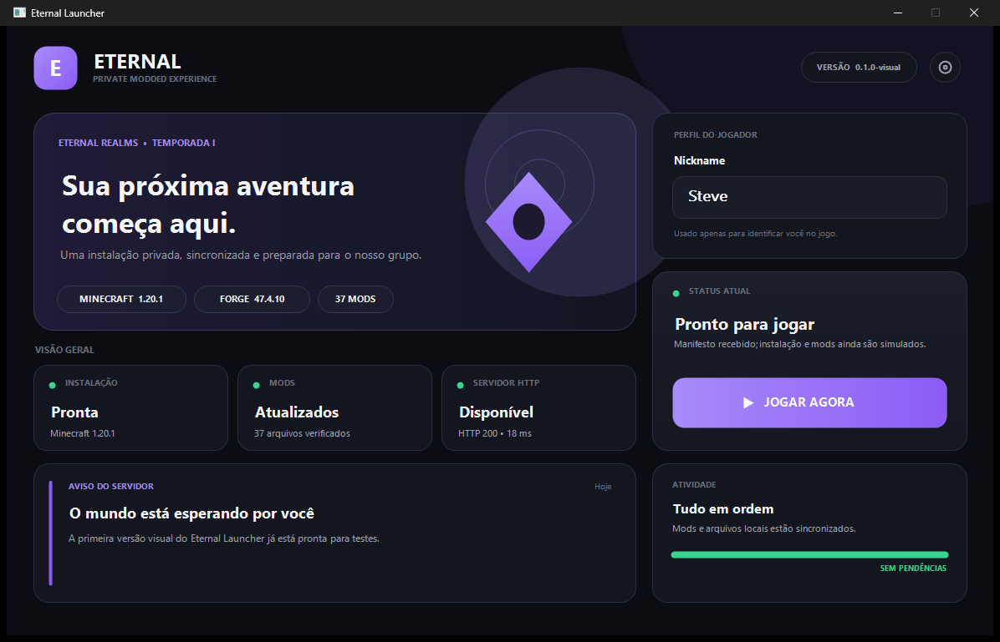

# Eternal Launcher

Launcher desktop privado para uma instalação padronizada de Minecraft `1.20.1`
com Forge `47.4.10`. A aplicação consulta um manifesto HTTP, prepara uma
instância isolada e inicia o jogo com o nickname informado.



## Funcionalidades atuais

- Interface nativa para Windows com tema escuro e componentes separados.
- Campo de nickname com validação de 3 a 16 letras, números ou `_`.
- Consulta assíncrona ao manifesto do servidor HTTP configurado.
- Download automático do Java 17 portátil pela API oficial do Eclipse Adoptium.
- Instalação automática do cliente Minecraft, bibliotecas, assets e Forge.
- Verificação de SHA-1/SHA-256 e publicação atômica dos downloads.
- Sincronização dos arquivos descritos em `files` no manifesto privado.
- Extração das bibliotecas nativas e geração de classpath controlado.
- Inicialização real do Forge e log técnico em `logs/launcher-console.log`.
- Instância isolada em `%APPDATA%\.eternal-launcher\minecraft`.

> A identidade ainda é local/offline, sem autenticação Microsoft. Os jogadores
> devem possuir o jogo e o servidor privado precisa aceitar sessões offline.

## Primeiro uso

Ao abrir, o launcher consulta somente o servidor e mostra se a instalação local
está pronta. Os downloads começam depois que você clica em **Jogar**:

```text
Preparar Java 17 portátil
  → consultar manifestos oficiais da Mojang
  → baixar e verificar Minecraft, bibliotecas e assets
  → extrair DLLs nativos
  → baixar e executar o instalador oficial do Forge 47.4.10
  → sincronizar os arquivos do manifesto privado
  → iniciar o jogo com o nickname escolhido
```

Downloads já válidos são reaproveitados. Arquivos incompletos usam a extensão
`.part` e só substituem o destino depois da conferência do hash.

## O que ainda é simulado ou futuro

- Notícias exibidas na tela principal.
- Persistência das demais preferências.
- Remoção automática de mods que saíram do manifesto.
- Autenticação Microsoft e modo online.
- Atualização automática do executável do launcher.
- Tela funcional de configurações.

## Tecnologias

- C++20, CMake e Win32 API;
- GDI+ para a interface;
- WinHTTP para downloads;
- Windows CNG (`bcrypt`) para hashes e UUID local;
- Eclipse Temurin 17 como runtime portátil.

Não existe acoplamento ao NGINX. Qualquer servidor HTTP capaz de publicar o
manifesto e os arquivos pode ser utilizado.

## Como compilar

No Visual Studio, abra a pasta, selecione um preset de `CMakePresets.json` e
compile o alvo `EternalLauncher`. Em um Developer PowerShell:

```powershell
cmake --preset x64-debug
cmake --build out/build/x64-debug
ctest --test-dir out/build/x64-debug --output-on-failure
./out/build/x64-debug/EternalLauncher.exe
```

Também existem os presets `x64-release`, `x86-debug` e `x86-release`.

## Organização

```text
assets/                       Recursos visuais futuros
docs/                         Documentação e capturas
src/
├── app/                      Ciclo de vida da aplicação
├── components/               Componentes visuais
├── config/                   Versões, URLs e memória
├── constants/                IDs e dimensões compartilhadas
├── mocks/                    Conteúdo ainda simulado
├── pages/                    Composição e interação das telas
├── services/                 HTTP, instalação e inicialização
├── styles/                   Paleta e tipografia
├── types/                    Estados compartilhados
└── utils/                    JSON, hashes, arquivos e desenho
tests/                        Testes automatizados e diagnósticos locais
```

Documentação complementar:

- [Arquitetura do projeto](docs/ARQUITETURA.md)
- [Inicialização do Minecraft](docs/INICIALIZACAO_MINECRAFT.md)
- [Servidor HTTP de arquivos](docs/SERVIDOR_HTTP.md)

## Configuração central

Versões, memória e servidor ficam em `src/config/LauncherConfig.h`. Para trocar
o IP atual, altere `FileServerBaseUrl` e recompile. O launcher obtém Minecraft
dos serviços oficiais e usa esse servidor apenas para o manifesto, mods,
configurações e outros arquivos privados.

O launcher não configura o servidor Minecraft automaticamente. Adicione o IP
manualmente na tela Multiplayer do jogo. Essa lista pertence à instalação
isolada em `%APPDATA%\.eternal-launcher\minecraft`.

O nickname válido é salvo automaticamente ao clicar em **Jogar** ou fechar o
launcher. Na próxima abertura ele reaparece no campo. O valor fica em
`%APPDATA%\.eternal-launcher\nickname.txt`; isso não é uma conta ou autenticação.

## TODOs principais

- Mover a URL HTTP e a memória para configurações persistidas.
- Remover arquivos locais obsoletos com uma política segura.
- Adicionar autenticação Microsoft, se desejado.
- Implementar atualização assinada do próprio launcher.
