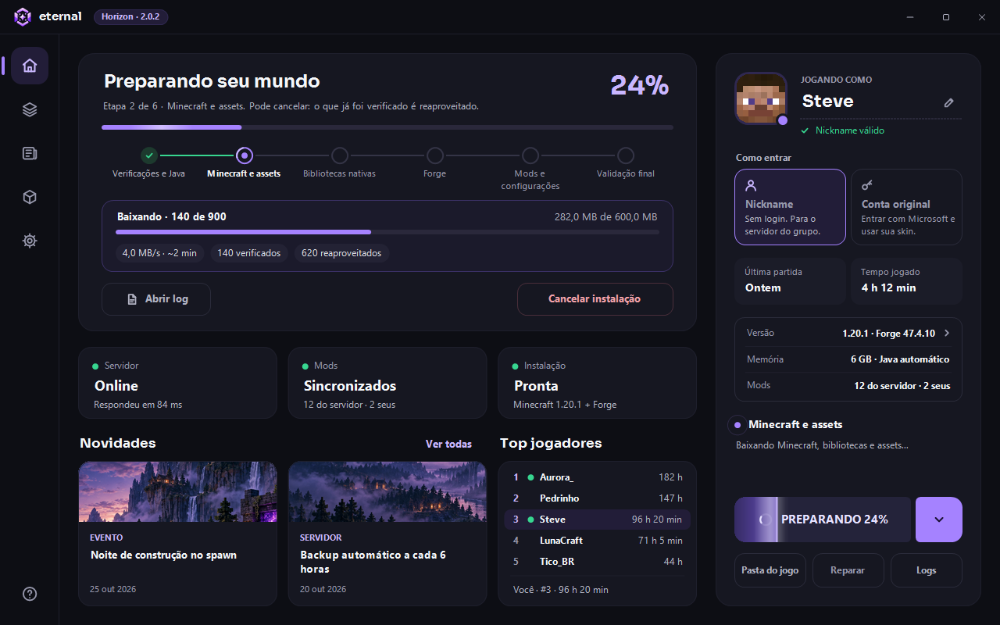
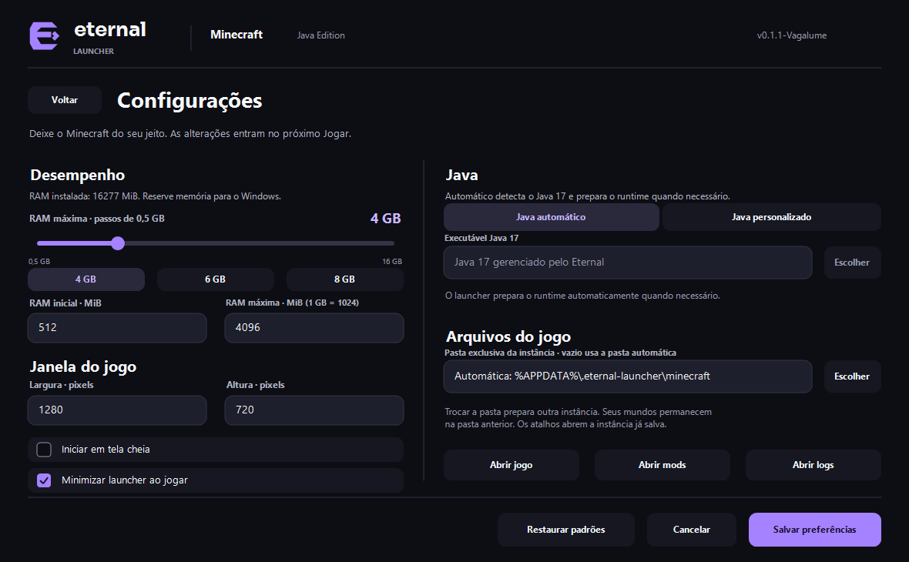

# User guide

How to install, use and configure Eternal Launcher. The launcher's interface is in
Brazilian Portuguese; UI labels are quoted as they appear in the app, followed by
their English meaning.

## Download and use

Download the latest `EternalLauncher.exe` from the
[releases page](https://github.com/ryanbworks/native-game-launcher/releases/latest).
The distribution is a single portable executable for Windows x64. The launcher ships
with the C++ runtime and sets up Java 17 automatically the first time you click
**Jogar** (Play), with an internet connection.

Users of v0.1.1-Vagalume need to replace the executable manually once. Since Aurora,
the launcher checks for new versions on startup and asks before downloading. After
you confirm with **OK**, it updates and restarts automatically. Preferences and game
files are preserved. If the update fails, the launcher lets you keep using the
installed version and offers a manual download.

Publishing a new version is described in [AUTOUPDATE.md](AUTOUPDATE.md) and
[server/GITHUB_ACTIONS.md](../server/GITHUB_ACTIONS.md).

## Accounts

In **Nickname** mode, the private server must accept offline sessions. The nickname
must have 3–16 letters, digits or `_`. A valid nickname is saved when you click
**Jogar** or close the launcher, in `%APPDATA%\.eternal-launcher\nickname.txt`; this
is not an account or authentication.

In **Conta original** (original account) mode, the launcher signs in with Microsoft
and gets the name, UUID and token of the account's Minecraft: Java Edition profile.
The session lives only in memory and is requested again when the launcher is
reopened. You can switch between the two modes at any time.

The avatar next to the name shows the face of the skin that belongs to that name,
looked up through Mojang's public API. Names without an original account show the
classic default face.

### Original login setup

The public Application (client) ID is configured in `src/config/LauncherConfig.h`
and ships with the compiled executable. To use a different registration without
rebuilding, set the environment variable before starting the launcher:

```powershell
$env:ETERNAL_LAUNCHER_MICROSOFT_CLIENT_ID = "YOUR-APPLICATION-CLIENT-ID"
./out/build/x64-debug/EternalLauncher.exe
```

The ID is public; never put a client secret in the executable. After choosing
**Conta original** and clicking **Jogar**, open the URL shown, enter the code and
finish signing in through the browser. The account must own a Minecraft: Java
Edition profile.

Microsoft/Mojang must also authorize the app registration. If the service responds
with `Invalid app registration` (HTTP 403), sign-in reached Minecraft Services but
the Application ID was rejected; rebuilding does not change that. The error points to
`https://aka.ms/AppRegInfo`, and approval is requested through Mojang's
[application registration form](https://forms.cloud.microsoft/Pages/ResponsePage.aspx?id=v4j5cvGGr0GRqy180BHbR-ajEQ1td1ROpz00KtS8Gd5UNVpPTkVLNFVROVQxNkdRMEtXVjNQQjdXVC4u).
Until then, Nickname mode remains available.

## First run

On startup, the launcher checks for its own update and then shows the state of the
local installation. Game downloads start when you click **Jogar**:

```text
Prepare portable Java 17
  → read Mojang's official manifests
  → download and verify Minecraft, libraries and assets
  → extract native DLLs
  → download and run the official Forge 47.4.10 installer
  → synchronize the private manifest's files
  → start the game with the chosen nickname
```

Downloads that are already valid are reused. Incomplete files use the `.part`
extension and only replace the destination after the hash is verified.

## Tracking and cancelling the installation

After clicking **Jogar**, a compact panel takes the place of the landscape at the top
of Home and shows six stages: checks and Java 17, Minecraft and assets, native
libraries, Forge, mods and configuration, and final validation. The status tiles,
news and leaderboard stay visible below it. Minecraft opens automatically when
preparation finishes successfully.

During transfers, the panel shows downloaded bytes, the current transfer's
percentage, speed, remaining time when it can be estimated, and verified/reused
files. Extraction, verification and the Forge run use an activity indicator.

**Cancelar instalação** (Cancel installation) requests a stop and shows
**Cancelando…** until tasks finish. **Continuar instalação** (Continue) and
**Tentar novamente** (Try again) read the manifests again and reuse complete,
verified files. Partial files are restarted; there is no byte-level resume.
Cancelling prevents the game from opening and preserves existing worlds.

Failures appear in the panel with recovery guidance. **Abrir log** (Open log) opens
`logs/installation.log` of the instance; Forge failures also point to
`logs/forge-installer.log`. Logs never include Microsoft identity, tokens or URLs
with credentials.



## Versions

The **Versões** (Versions) page has a card for each game. **Usar esta versão** (use
this version) selects it and **Jogar** starts it. Minecraft 1.8.9 is unmodified, for
public minigame servers, and uses its own folder
(`%APPDATA%\.eternal-launcher\minecraft-1.8.9`) and a portable Java 8, without
touching the modpack. Its time does not count on the leaderboard. Nickname mode only
reaches servers that accept it. Details are in
[MINECRAFT_LAUNCH.md](MINECRAFT_LAUNCH.md#minecraft-189-without-mods).

## Play time and leaderboard

While the modpack runs, the launcher tells the server every minute that the session
is still open, and the server adds up the time with its own clock. The launcher
never sends a duration, so editing a local file changes nothing. The only exception
is a one-time import of the time saved by older versions: once per nickname, up to
200 hours, for 60 days after the service went live. See
[server/INSTALL.md](../server/INSTALL.md#play-time-and-leaderboard).

## Settings

Open the gear icon to adjust:

- Maximum RAM slider in 0.5 GB steps, with 4, 6 and 8 GB shortcuts.
- Initial/maximum RAM fields in MiB (512 to 65536; initial cannot exceed maximum).
- Window width and height, with an option to start in fullscreen.
- Automatic Java 17 or a custom executable (`java.exe` / `javaw.exe`).
- Dedicated instance folder and minimizing the launcher while playing.

In the slider, 1 GB equals 1024 MiB. Slider, shortcuts and numeric field stay in
sync; if a shortcut lowers the maximum below the initial value, the initial value is
lowered too.

**Salvar preferências** (Save) applies the values from the next session. **Cancelar**,
**Voltar** or Esc discard unsaved changes. **Restaurar padrões** (Restore defaults)
fills in the form; click Save to apply. Values are stored in
`%APPDATA%\.eternal-launcher\settings.json` with atomic writes. An invalid file is
preserved and the launcher loads the defaults, showing a warning.

Automatic mode looks for Java 17 in the private runtime, in `JAVA_HOME` and on the
`PATH`, and prepares the private runtime when needed. Preferences are locked during
login, preparation and while Minecraft is running.

Changing the folder prepares a different instance: your worlds stay in the previous
folder. The default `.minecraft` folder, the drive root and the launcher's internal
data are protected.



## Server administration

Memory, game versions and the server address live in `src/config/LauncherConfig.h`;
to change the server, edit `FileServerBaseUrl` and rebuild. The launcher gets
Minecraft from the official services and uses this server only for the manifest,
mods, configs and other private files.

The launcher does not add the Minecraft server automatically; add the IP on the
game's Multiplayer screen.

To distribute mods, upload the `.jar` files to the server's `files/mods/` folder
(configs go to `files/config/`, keeping the path Minecraft expects). A service on the
server updates the manifest automatically, and the launcher fetches the latest list
when you click **Jogar**. Setup is described in [server/INSTALL.md](../server/INSTALL.md)
and [HTTP_SERVER.md](HTTP_SERVER.md).
